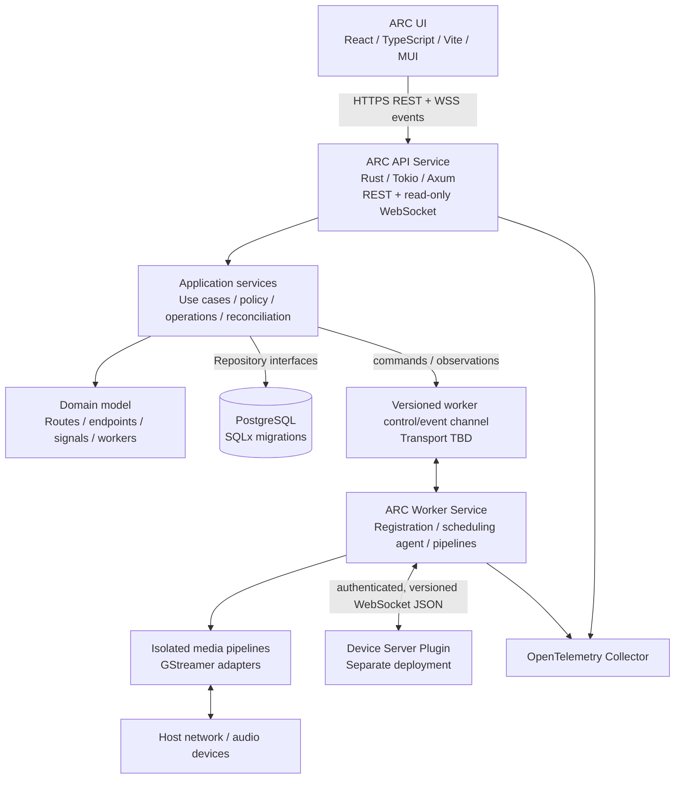

# C4 Containers - ARC POC

**Status:** Draft for approval

## Container responsibilities and boundaries

| Container | Owns | Interface / data |
|---|---|---|
| ARC UI | Administration screens, query cache, local pending crosspoints, live event subscription | HTTPS JSON and read-only WSS; no direct database/media access |
| ARC API | Authentication, authorization, HTTP contract, event stream, API composition | OpenAPI 3.1 `/api/v1`; application-service calls |
| Application services | Validation, revision/idempotency checks, operations, routing, placement, reconciliation, audit | Domain commands and infrastructure ports |
| PostgreSQL | Desired configuration, revisions, operations, assignments, auth metadata, audit, replay/idempotency metadata | SQLx repositories and versioned migrations |
| ARC Worker | Host interface discovery, registration/heartbeat/capabilities/capacity, pipeline lifecycle, signal/GPIO, health | Versioned worker protocol; local scheduler and capacity implementations in POC |
| Media pipeline runtime | One or more isolated source/route/destination graphs | GStreamer-backed adapters behind framework-neutral ports |
| Device Server Plugin | Native host integration, translating Device Server contract to ARC protocol | Independent artifact; no PostgreSQL or direct ARC internals |
| OTel collector | Receives/export telemetry | OTLP and deployment-configured receivers/exporters |

API and worker can be colocated but are separate processes/containers and use
the same versioned contracts used by future remote workers. The worker control
transport is intentionally not fixed by the references; choose and document
one during Phase 0. Device Server WebSocket JSON is specifically preferred for
the plugin boundary.

## Trust boundaries

1. Browser/client to API: TLS, authentication, authorization, rate/size limits.
2. API/worker: authenticated service identity, bounded commands, generation
   checks, and worker capability validation.
3. Worker/media to host devices/network: explicit interface/device selection
   and OS/container permissions.
4. ARC/plugin: mutual authentication or equivalent credentialed channel,
   protocol version negotiation, input validation, replay/reconnect handling.
5. ARC services to PostgreSQL/telemetry: least-privilege credentials and
   secret-provider references.
