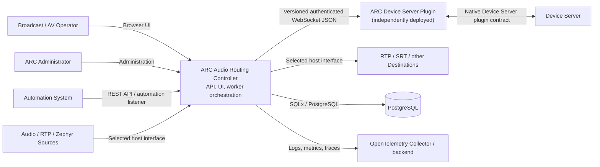

# C4 Context - ARC

**Status:** Draft for approval

## People and external systems

- **Operator/administrator:** manages endpoints, routes, presets, signal
  mappings, permissions, and runtime health through the browser or API.
- **Automation system:** uses the versioned REST API and, where approved, a
  distinct TCP/TLS automation command listener. The listener is not an HTTP API
  replacement and is not coupled to the Zephyr UDP receiver.
- **Media sources/destinations:** send/receive media through explicitly chosen
  worker host interfaces.
- **Device Server:** exchanges GPIO, crosspoint, state snapshot, and health
  operations through a separately deployed ARC plugin.
- **PostgreSQL:** stores durable desired state and operational records.
- **Telemetry backend:** receives OpenTelemetry data; implementation choice is
  deployment-specific.

The ARC box is decomposed in [C4 containers](c4-container.md). This context
diagram is conceptual and does not imply a deployed cloud service or a
particular Device Server vendor.
