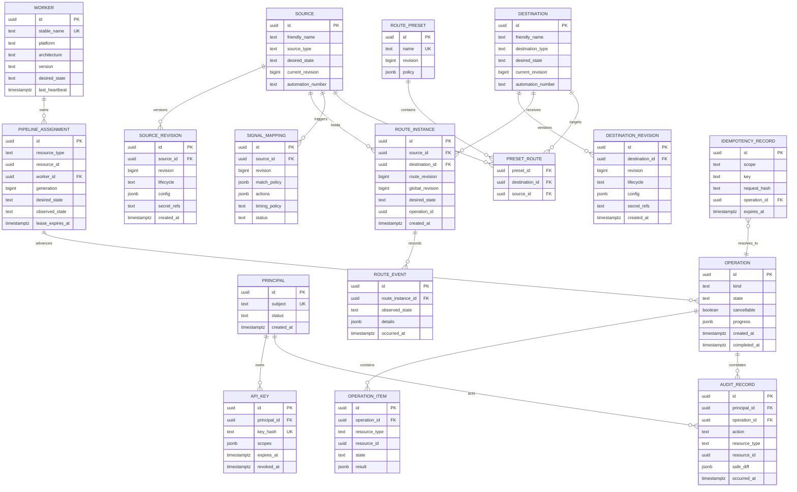

# PostgreSQL Database ERD

**Status:** Approved architecture baseline; initial migration and SQLx runner
validated; repository and upgrade/recovery coverage remains planned
**Database:** PostgreSQL only; SQLx migrations are the schema-versioning
mechanism. SQLite and a multi-database abstraction are out of scope.

## Modeling decisions

- Source/destination identity is stable; immutable revisions hold draft,
  validated, and active configurations. Never store secret values in `jsonb`;
  persist secret references only.
- Interface selection is a stable host-interface identifier in the relevant
  revision config. Live inventory is observed worker state and may change; API
  should expose it without treating it as durable configuration.
- Desired routes are unique by destination (at most one source per
  destination). Route instances/history are immutable and revisions are
  monotonic. Encode the one-source constraint with a unique active desired
  destination key or equivalent transactional constraint.
- Assignments carry desired/observed states, worker lease and monotonically
  increasing generation. Worker heartbeat/capacity telemetry is not an
  unbounded durable time series; retain only operationally useful snapshots.
- Operations are durable for recovery and clients; operation items record
  independent batch outcomes. Idempotency keys are scoped and expire by
  operation class. Audit payloads are redacted and append-only by application
  policy.
- Event sequence/replay metadata, auth users/roles, secrets, device connections,
  backups, licensing, locks, and configuration import/restore may require
  additional normalized tables based on reviewed retention and ownership
  decisions; see [open questions](open-questions.md).

The Phase 0 migration scaffold is in `database/migrations/0001_initial.sql`;
it has been applied to PostgreSQL 16, including current-revision foreign keys
and route cardinality validation; the SQLx migrator test also passes against a
disposable PostgreSQL 16 database. Upgrade/recovery paths still require
integration tests. Migrations must add indexes for foreign keys, resource/revision lookups,
operation state, lease expiry, and idempotency uniqueness; use transactions and
test both clean installation and upgrade paths. JSONB is for adapter-specific
configuration, not core relational invariants.
