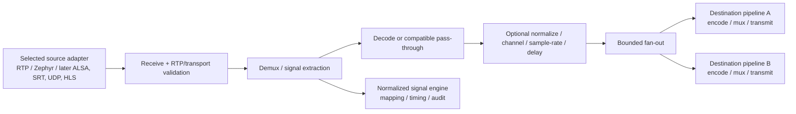

# Media Pipeline Design

**Status:** Approved architecture baseline

## Abstraction boundary

Application/domain code expresses a pipeline plan using ARC-owned media
contracts. Only infrastructure adapters depend on GStreamer. Required ports:

```text
SourceAdapter       -> source capabilities, validation, receive/decoded stream
DestinationAdapter  -> output capabilities, validation, transmit
MediaPipeline       -> prepare/start/stop/reconfigure/health/metrics
SignalExtractor     -> parse transport/media-carried signals
SignalGenerator     -> emit normalized signals to supported outputs
```

Represent media as typed stream descriptors (codec, sample rate, channel
layout, clock/timestamp domain, transport, payload/container and signal
capabilities), not GStreamer element references. A planner selects
pass-through when compatible, otherwise a supported decode/normalize/encode
path. Enforce destination codec policy (`prefer-pass-through`, `force-encode`,
`pass-through-only`) and explain incompatibility before apply.

## Pipeline topology



Each destination branch has bounded queues, independent health, and explicit
backpressure/drop policy. Slow or failed outputs cannot stall source processing
or sibling branches. Use operation-scoped pipeline IDs and assignment
generations; stale workers must not activate older graphs. Metrics include
packet loss/reorder/jitter where applicable, decode/encode errors, queue level,
buffer delay, bitrate, and effective stream format.

## Lifecycle and failure policy

`planned -> preparing -> running -> degraded|failed -> stopping -> stopped`
is observed runtime state; desired enabled/route state remains durable. Validate
and reserve resources before committing the desired change. Isolate restart to
one pipeline. Recover from the next valid framing/timestamp boundary, count
concealment/discard/silence, and never repeat the last frame indefinitely.
Keep failures and resource-admission reasons visible in the operation and
health APIs.

Route replacement, multi-route best-effort batches, and rollback are
application operations over independent runtime actions, not a fictional
GStreamer-wide database transaction. For replacement, persist the previous
assignment snapshot, prepare the replacement while the previous assignment is
still running, then stop the previous route and start the replacement. This is
a hard cut, not a crossfade. A preparation failure leaves the old route active;
a failed replacement Start triggers durable compensation that plans and starts
the previous pinned route. Report per-destination progress and clearly surface
when automatic recovery exhausts its retry budget.

## POC profiles and sequence

Phase 1 source choices are SRT MPEG-TS, RTP L16, RTP L24, and ALSA (48 kHz
stereo L16). Outputs remain RTP L16/L24 and SRT MPEG-TS. Preserve V6's other
technical requirements, including PostgreSQL persistence, local worker
assignment, health/events, and restart recovery. Exact plugin packages and
platform license choices remain open and must not be selected implicitly.

The original RTP MPEG-TS (MP2T, payload type 33) -> SRT MPEG-TS pass-through
path remains supported for existing source records, but is no longer offered
for new sources. ALSA -> RTP L16 uses 48 kHz stereo PCM with the RTP endpoint's
dynamic payload type configured locally. The user approved LGPL GStreamer
components and the MPL-2.0 SRT library for Phase 1, excluding GPL/AGPL
components; the exact plugin and OS package closure still needs inventory.

The Phase 1 planner supports ALSA L16 -> RTP L16, RTP L16 -> RTP L16, RTP L24
-> RTP L24, SRT MPEG-TS -> SRT MPEG-TS, and the retained RTP MP2T -> SRT MPEG-TS
path. RTP L16/L24 endpoints configure their dynamic payload types
independently. No L16/L24 conversion or cross-format SRT path is implied.

The worker's `arc-gstreamer` adapter now builds those five paths from the
typed, revision-pinned source and destination profiles; it does not accept
arbitrary GStreamer launch strings. It verifies the planned requirements
against the stored profiles, checks assignment generations during lifecycle
operations, and reports GStreamer state and bus errors through `MediaPipeline`.
Worker readiness advertises only adapter factories present in the runtime image.
ALSA is opt-in because it also requires host audio-device access.

The automated media-plane loopback test sends RTP MP2T (payload type 33) into
the adapter, passes its seven MPEG-TS packets to a local SRT listener, and
verifies that the original bytes arrive unchanged. SRT output sinks disable
asynchronous preroll while retaining clock synchronization so a live pipeline
can start before its first input packet. This validates the adapter path only;
API/UI-to-worker orchestration and deployed-network acceptance remain open.

Editing a disabled source or destination creates a new draft revision and
preserves prior revisions. The updated resource remains disabled until its
current draft is validated; enabled resources cannot be edited.

Starting an assignment atomically enables its pinned source and destination
before dispatch. Resources remain enabled while a pipeline is starting, running,
or stopping. After worker Stop acknowledgement, each resource is disabled only
when no other active assignment references it; unstarted plans do not enable
resources. A known pre-dispatch Start failure resets the assignment and disables
unused resources, while uncertain worker outcomes keep the resources enabled
until reconciliation or acknowledged Stop.

Zephyr remains the V6 Phase 2 adapter: same-socket RTP demux, AAC-LC/ADTS
decode, GPIO extraction, and synthetic simulation. Zephyr POC profile: 48 kHz
stereo AAC-LC/ADTS; audio/GPIO SSRC and PT configured per channel; exact sender
IP/UDP source-port; up to five channels; selected interface/bind address;
bounded RTP reorder and ADTS reassembly; editable 500 ms decoder delay. See
[the adapter design](zc-adapter-design.md).

## Capacity and portability

The internal Phase 1 estimator first validates and selects one of the five
supported one-source, one-destination paths. It produces the corresponding
source and destination adapter requirements and a provisional cost of two
normalized units: one for the source side and one for the destination side.
ALSA additionally requires Linux and the `alsa` audio backend. No decode,
conversion, fan-out, signal extraction, delay, or preview work is modeled by
these paths. Adding those features requires extending the estimator.

Route placement keeps assignments for an already-planned or active source
revision on its existing worker. Worker pipeline specifications carry an
optional source identity (source ID and revision). When present, GStreamer
creates one source graph per identity and connects destination branches through
a tee. Each branch has a bounded 100-buffer queue that drops its oldest buffers
when the destination falls behind, and branches can start or stop independently
without stopping active siblings. Capacity reservations are still charged per
route. Capacity admission now counts the source-ingestion unit once per
`(worker, source_id, source_revision)` and retains one destination-branch unit
per route. Stored reservations keep their full per-route requirements, while
placement and assignment rechecks apply the shared-source credit consistently.
An isolated PostgreSQL test covers concurrent placement, additional branch
capacity, and rejection when the pinned worker is full. Injected branch-failure
acceptance remains open.

The estimate records 1,536,000 bits/s of outbound audio payload for ALSA
48 kHz stereo L16 to RTP; it excludes protocol overhead. Other ingress and
egress payload rates are unknown because the current profiles do not specify
the necessary stream properties. Unknown is represented as `None`, not zero;
actual network use, including a network-backed ALSA device, may be higher.

These are deterministic POC placeholders, not measured capacity limits or
proof that a worker or network can safely carry a stream. Their provisional
units feed worker placement and reservation, but network bandwidth, memory,
transport overhead, and variable stream costs are not fully measured yet.
The POC now admits ingress/egress limits and OS-derived CPU/memory pressure
reported by each worker, with optional static overrides; normalized capacity
units remain provisional.
Calibrate resource costs and add the missing dimensions before relying on
estimates for real media admission. Advertise actual
GStreamer elements/codecs, audio backends, platform, architecture, and hardware
acceleration per worker. Linux x86-64/ARM64 Docker and Windows x86-64 are
targets subject to explicit plugin/codec availability and license validation.

The route planning API and compatibility view expose the provisional units and
payload rates alongside the existing media path. Planning does not check or
reserve worker capacity. The UI explicitly reports when an older API does not
provide an estimate and hides results that no longer match the selected
profiles.

Separately, an internal pipeline planning transaction uses the same estimator
to reserve capacity and create a planned assignment together. It is not called
by the compatibility API and does not persist a route or start media.
