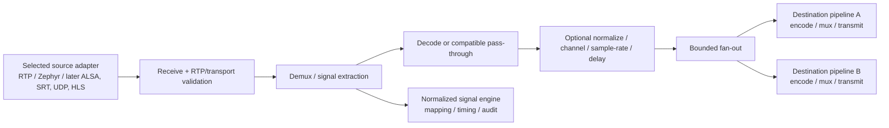

# Media Pipeline Design

**Status:** Approved architecture baseline

## Abstraction boundary

Application/domain code expresses a pipeline plan using ARC-owned media
contracts. Only infrastructure adapters depend on GStreamer. Required ports:

```text
SourceAdapter       -> source capabilities, validation, receive/decoded stream
DestinationAdapter  -> output capabilities, validation, transmit
MediaPipeline       -> prepare/start/stop/reconfigure/health/metrics
SignalExtractor     -> parse transport/media-carried signals
SignalGenerator     -> emit normalized signals to supported outputs
```

Represent media as typed stream descriptors (codec, sample rate, channel
layout, clock/timestamp domain, transport, payload/container and signal
capabilities), not GStreamer element references. A planner selects
pass-through when compatible, otherwise a supported decode/normalize/encode
path. Enforce destination codec policy (`prefer-pass-through`, `force-encode`,
`pass-through-only`) and explain incompatibility before apply.

## Pipeline topology



Each destination branch has bounded queues, independent health, and explicit
backpressure/drop policy. Slow or failed outputs cannot stall source processing
or sibling branches. Use operation-scoped pipeline IDs and assignment
generations; stale workers must not activate older graphs. Metrics include
packet loss/reorder/jitter where applicable, decode/encode errors, queue level,
buffer delay, bitrate, and effective stream format.

## Lifecycle and failure policy

`planned -> preparing -> running -> degraded|failed -> stopping -> stopped`
is observed runtime state; desired enabled/route state remains durable. Validate
and reserve resources before committing the desired change. Isolate restart to
one pipeline. Recover from the next valid framing/timestamp boundary, count
concealment/discard/silence, and never repeat the last frame indefinitely.
Keep failures and resource-admission reasons visible in the operation and
health APIs.

Route replacement, multi-route best-effort batches, and rollback are
application operations over independent runtime actions, not a fictional
GStreamer-wide database transaction. Preserve old assignment until replacement
readiness where product policy permits; disclose hard-cut behavior and
compensation outcomes.

## POC profiles and sequence

The user selected the invoked prompt's Phase 1 adapter scope: ALSA and RTP
inputs, RTP and SRT outputs, with RTP input -> SRT output as the first
end-to-end demo. Preserve V6's technical requirements where they do not
conflict, including PostgreSQL persistence, local worker assignment,
health/events, and restart recovery. SRT output uses MPEG-TS per V6. The RTP
payload profiles are recorded below; exact plugin packages and platform
license choices remain open and must not be selected implicitly.

The user selected RTP MPEG-TS (MP2T, payload type 33) -> SRT MPEG-TS
pass-through for the first demo. The ALSA -> RTP profile is 48 kHz stereo L16
PCM; its dynamic RTP payload type is destination configuration, not a global
constant. This avoids an audio encoder. The user approved LGPL GStreamer
components and the MPL-2.0 SRT library for Phase 1, excluding GPL/AGPL
components; the exact plugin and OS package closure still needs inventory.

The user additionally selected RTP L24 audio profiles for both inputs and
outputs using the existing 48 kHz stereo PCM baseline. The Phase 1 planner
accepts RTP L24 -> RTP L24 only, with each endpoint's dynamic payload type
configured independently. It does not imply L16/L24 conversion or an RTP L24
-> SRT path.

Zephyr remains the V6 Phase 2 adapter: same-socket RTP demux, AAC-LC/ADTS
decode, GPIO extraction, and synthetic simulation. Zephyr POC profile: 48 kHz
stereo AAC-LC/ADTS; audio/GPIO SSRC and PT configured per channel; exact sender
IP/UDP source-port; up to five channels; selected interface/bind address;
bounded RTP reorder and ADTS reassembly; editable 500 ms decoder delay. See
[the adapter design](zc-adapter-design.md).

## Capacity and portability

Estimate repeatable per-pipeline resource requirements (transport, demux,
decode, conversion, fan-out, encode/mux, delay-buffer memory, preview, and
network bandwidth). The POC estimator is deterministic and bounded; placement
uses compatibility and safe capacity, not CPU alone. Advertise actual
GStreamer elements/codecs, audio backends, platform, architecture, and hardware
acceleration per worker. Linux x86-64/ARM64 Docker and Windows x86-64 are
targets subject to explicit plugin/codec availability and license validation.
